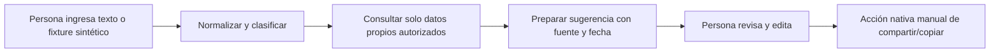
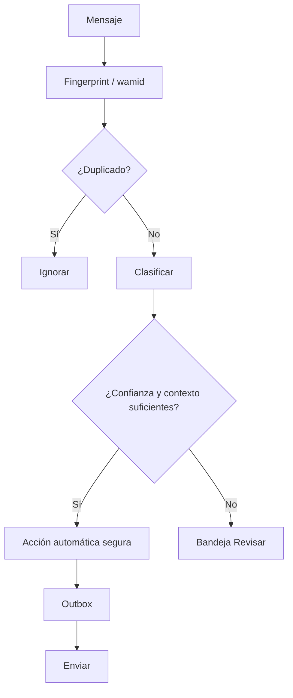

# Automatización de WhatsApp

> **Enforcement de lectura #1011 (2026-10-16):** además del NO-GO de autoenvío, el Bridge ya rechaza todo inicio de lectura automática en Messenger real, incluido `history:v130`, `live:v130`, captura de grupos, preflight y servidor. El bloqueo es previo a iniciar Chromium, el perfil y el spool; no existe flag para levantarlo. El laboratorio permitido opera con datos sintéticos locales. Véase [SOURCE_AUTO_READ_NO_GO_V1011.md](SOURCE_AUTO_READ_NO_GO_V1011.md). Las secciones históricas siguientes son referencia, no instrucciones para conectar el grupo real.

> **Canal de producto vigente (owner, 2026-10-15):** el caso solicitado es un grupo privado de amigos en **WhatsApp Messenger normal**, con apuestas recreativas sin dinero real ni efectos económicos. No se usará WhatsApp Business ni ninguna de sus API. El patrón Business Platform descrito debajo es documentación histórica/benchmark, no la arquitectura seleccionada ni autorización para conectar Messenger. Las Condiciones del servicio de Messenger restringen mensajería automática y uso no personal salvo autorización expresa; conservar autoenvío SOURCE en `NO-GO` mientras no exista evidencia de permiso. Avanzar con LAB sintético y respuestas sugeridas que una persona comparte manualmente. Ver [ticket #1011](../market-research/CONTROL_HIPICO_TICKET_WHATSAPP_POLICY_2026-10-14.md) y [revisión de cumplimiento](WHATSAPP_PRODUCTION_COMPLIANCE.md).

El resto de este archivo documenta contratos y respuestas del Bridge histórico (incluidas funciones operativas de otros perfiles). No asumir que cualquier función de saldos/liquidación descrita abajo se aplica al grupo recreativo ni conectarla a sus puntuaciones virtuales. El diagrama y el contrato de outbox describen capacidades existentes, no una autorización para conectar el Messenger real desde SOURCE o LAB.

## Diseño de referencia anterior: Business Platform (fuera del alcance seleccionado)
La propuesta anterior del conector usaba el patrón de WhatsApp Business Platform Cloud API: verificación de webhook, firma `x-hub-signature-256`, recepción en backend, persistencia idempotente y outbox de envío. Se conserva como referencia histórica para sus tests/contratos existentes. No habilitarla como canal de este producto ni cambiar el objetivo a Business.

La integración de grupos ordinarios no se da por supuesta. Antes de activar automatización de un grupo existente se debe verificar que la cuenta y el producto oficial de Meta soporten ese escenario. No se autoriza basar producción en automatizaciones de WhatsApp Web no oficiales que puedan romperse o arriesgar el número.

## Flujo vigente del grupo Messenger (sin conexión automática)

Este flujo no inicia sesión, no lee el grupo y no envía mensajes en background. Una sugerencia puede avanzar solo con los gates de privacidad y seguridad.

## Pipeline histórico del Bridge (no habilitado para Messenger normal)

El pipeline siguiente describe la arquitectura previa de automatización y no está autorizado para el grupo recreativo actual:

## Respuestas
- Silencio para conversación normal.
- Acuse corto para solicitud válida cuando aporte valor.
- Contraoferta/confirmación actualiza la misma solicitud.
- Tras el cierre, las nuevas ofertas quedan fuera o en el siguiente bloque; nunca se mezclan automáticamente.
- La llegada cambia el estado a resultado recibido; la liquidación monetaria conserva un gate de revisión mientras el sistema no alcance historial suficiente de cero discrepancias.
- Saldo individual se responde preferiblemente al participante, no saturando el grupo.

## Idempotencia
Prioridad: `wamid` oficial. Fallback para chat exportado: hash de grupo + remitente + hora + texto normalizado + cita. La outbox tiene una `idempotency_key` independiente para impedir dobles respuestas tras reintentos.
